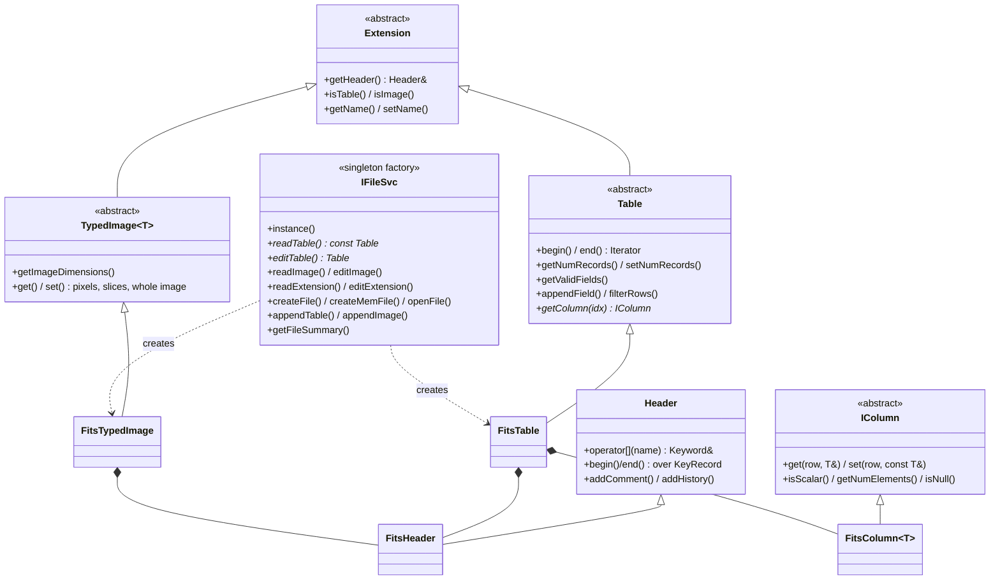

# tip Architecture

**tip** ("Table Interface Package") is the file I/O layer of the Fermitools.
Nearly every tool that reads or writes a FITS file goes through it. It wraps
cfitsio behind abstract `Table`, `Image` and `Header` interfaces with
STL-style iteration.

## Purpose and scope

**Does:**
- Open existing FITS extensions (binary/ASCII tables and images) read-only or
  read-write, by file name and extension name, with optional cfitsio
  row-filter expressions.
- Provide row iteration over tables, with typed per-cell `get`/`set` and
  automatic type conversion (delegated to cfitsio).
- Read and write header keywords, comments, units, COMMENT and HISTORY.
- Create files (optionally from a FITS template), append tables and images,
  add columns, resize tables, and create in-memory files.
- Provide a small linear-interpolation utility over sorted tables.

**Does not:**
- Buffer or cache data itself. All buffering is cfitsio's (see
  [Invariants and gotchas](#invariants-and-gotchas)).
- Understand physics or FT1/FT2 semantics. Column and keyword meaning is up
  to the clients; `st_facilities`, `dataSubselector` and others build that on
  top of tip.
- Support ROOT files in the CMake build, even though ROOT code exists.
- Do WCS or coordinate handling.

## Position in the system

| Direction | Package | Why |
|-----------|---------|-----|
| Depends on | `cfitsio` (external) | All actual file access. Linked `PUBLIC`, so clients also get `fitsio.h` on their include path. |
| Depends on | `facilities` | Linked `PUBLIC` in CMake, but used only by the test program (`commonUtilities::getDataPath`). The library sources do not include it. |
| Optional | ROOT | `RootTable.cxx` is compiled when `FERMI_BUILD_ROOT=ON`, but it is unreachable (see gotchas). |
| Used by | 19 built packages, all real users (`#include` plus `tip::` symbols) | Heaviest: `Likelihood`, `irfs`, `evtbin`, `dataSubselector`, `SolarSystemTools`, `fitsGen`. The unbuilt `skymaps` also includes it. |

tip has no dependencies on other Fermi science packages, so it sits at the
bottom of the `io` tier. Changes to its public headers force a rebuild of
most of the tree.

## Key abstractions

All public types live in namespace `tip`, with headers in `tip/`.
FITS-specific implementations are in `src/` and are **not** part of the API.



| Type | Header | Role |
|------|--------|------|
| `IFileSvc` | `tip/IFileSvc.h` | Singleton factory and the only way clients obtain `Table`/`Image`/`Extension` objects. Also does whole-file operations. |
| `Extension` | `tip/Extension.h` | Common base for one HDU: header access, name, table-or-image. |
| `Table` | `tip/Table.h` | Abstract table. Nested typedefs: `Iterator`, `ConstIterator`, `Record`, `ConstRecord`, `Cell`, `FieldCont`. |
| `TableRecord` / `ConstTableRecord` | `tip/Table.h` | A *cursor* over one row: a table pointer plus a row index, with a lazily populated `std::map<std::string, TableCell>`. |
| `TableCell` | `tip/Table.h` | Binds a record to a field name and forwards `get`/`set` to the column's `IColumn` at the record's current row. |
| `RandomAccessIterator` | `tip/Iterator.h` | Generic iterator that owns one record object and moves its row index. |
| `IColumn` | `tip/IColumn.h` | Typed accessor for one column. Overloads `get`/`set` for every primitive type, `std::string`, `BitStruct`, and `std::vector` of each. |
| `Header` / `Keyword` | `tip/Header.h` | `Header::operator[]` returns a `Keyword` proxy whose templated `get`/`set` forward to virtual `getKeyword`/`setKeyword` overloads. |
| `KeyRecord` | `tip/KeyRecord.h` | A detached copy of one 80-character card, with name, value and comment parsing. |
| `TypedImage<T>` / `Image` | `tip/Image.h` | Image access by pixel, slice, or whole array. `Image` is `TypedImage<float>`. |
| `TipFile` / `ITipFile` | `tip/TipFile.h` | Handle on a whole file. Mainly used for in-memory files (`createMemFile`) and `copyFile`. |
| `FileSummary` / `ExtSummary` | `tip/FileSummary.h` | Ordered list of extension IDs (EXTNAME, else HDUNAME, else HDU number − 1). |
| `LinearInterp` | `tip/LinearInterp.h` | Linear interpolation between two rows of a table sorted on a key field. |
| `TipException` | `tip/TipException.h` | The only exception type. `code()` carries the cfitsio status when one exists. |
| `tip_types.h` | | `Index_t`/`IndexDiff_t` (`signed long`), `FieldIndex_t` (`int`), `PixOrd_t` (`signed long`). |

Implementation classes (`src/`):
- `FitsHeader`: owns the `fitsfile *` for one HDU, plus a vector of
  `KeyRecord`s loaded at open.
- `FitsTable`: owns a `FitsHeader` and one `FitsColumn<T>*` per column,
  chosen from the column's cfitsio type code.
- `FitsColumn<T>`: per-column metadata (repeat count, variable-length flag,
  TFORM, units, display width) and the cfitsio read/write calls.
- `FitsTypedImage<T>`, `FitsTipFile`, `FitsFileManager` (static whole-file
  helpers).
- `FitsPrimProps<T>`: type traits that map a C++ type to a cfitsio type code
  and to tip's null sentinel.

## Data flow and control flow

### Opening a table

```
IFileSvc::instance().readTable(file, ext, filter)
  └─ classifyFile(file)                    // fits_open_file probe; throws "File not found"/"not in FITS format"
  └─ new FitsTable(file, ext, filter, read_only=true)
       └─ FitsHeader(...)::open()
            ├─ fits_open_file("file[ext][filter]", READWRITE or READONLY)
            ├─ loadAllKeywords()            // snapshot of every card into m_keyword_seq
            └─ resolve EXTNAME/HDUNAME, detect table vs image
       └─ FitsTable::openTable()
            ├─ fits_get_num_rows
            └─ for each column: getColumnInfo() → new FitsColumn<T> keyed by lower-cased name
```

The caller owns the returned raw pointer. Destroying it closes the
`fitsfile`. For writable HDUs, closing also updates the checksums.

### Reading a cell

```
for (Table::ConstIterator it = t->begin(); it != t->end(); ++it)
  (*it)["energy"].get(value);
      │        └─ TableCell::get<T> → Table::getColumn(fieldIndex)->get(row, value)
      │                                 └─ FitsColumn<T>::getScalar<U> → fits_read_col(type(U), col, row+1, …)
      └─ ConstTableRecord::operator[] → find_or_make(field)   // std::map lookup; inserts a TableCell on first use
```

Each `get`/`set` is one cfitsio call for one cell. The C++ type requested by
the caller (`U`) sets the cfitsio data type, so cfitsio does all the
conversion. The column's stored type `T` matters only for `copy()` and for
how strings and bools are handled.

### Writing

`editTable`/`editImage` open read-write. `set()` calls `fits_write_col[null]`.
Header `set()` calls `fits_update_key`. Nothing is staged in tip: writes go
straight into cfitsio's buffers and reach disk at flush or close.

### Creating files

`IFileSvc::createFile(name, template)` creates the file with cfitsio's
`"!name(template)"` syntax, then runs
`FitsFileManager::collapseCommentContinuations`. That step rewrites cards
where cfitsio used CONTINUE only because the comment was long. Clients then
reopen the file with `editTable`. `createMemFile` does the same thing in
memory (`mem://`) and returns a `TipFile`, which must outlive any tables
opened through it. Use `TipFile::copyFile` to persist it.

## Public interfaces

### C++ API

Clients include headers from `tip/`. Most only need
`tip/IFileSvc.h`, `tip/Table.h` and `tip/Header.h`. Canonical usage:

```cpp
#include <memory>
#include "tip/IFileSvc.h"
#include "tip/Table.h"

std::unique_ptr<const tip::Table> table(
    tip::IFileSvc::instance().readTable("ft1.fits", "EVENTS", "ENERGY > 100"));

double tstart;
table->getHeader()["TSTART"].get(tstart);

// Bind the record and cells once, outside the loop (see gotchas).
tip::Table::ConstIterator it = table->begin();
tip::ConstTableRecord & rec = *it;
const tip::TableCell & energy = rec["energy"];
double e;
for (; it != table->end(); ++it) { energy.get(e); /* ... */ }
```

Vector-valued cells: `cell.get(std::vector<double> &)` and
`cell.getNumElements()`.
Column metadata: `table->getColumn(table->getFieldIndex("energy"))`, which
returns an `IColumn *` with `getUnits()`, `isScalar()`, `getFormat()` (TFORM)
and `getColumnKeyword("TLMIN")`.

**Deprecated, do not use in new code:** `IFileSvc::getSvc()`,
`Table::Scalar<T>`, `Table::Vector<T>`, `ScalarAdaptor`, `VectorAdaptor`.

### Applications

None. tip ships a library and the `test_tip` executable. `src/sample/sample.cxx`
is built only by the legacy SCons build.

### Python

None directly. tip is not wrapped by SWIG. Python users reach FITS data
through other means, such as astropy in pyLikelihood scripts.

### Environment variables

The library reads none. The test program finds its data through
`FERMI_INST_DIR` (see *Build and test*).

### File formats

FITS, through cfitsio. The full cfitsio extended filename syntax works in the
`file_name` argument and the `filter` argument: `file.fits[EVENTS][col X;Y]`,
row filters, `mem://`, compressed files, and so on.

## Build and test

- **CMake target:** `tip` (shared library). It always defines
  `BUILD_WITHOUT_ROOT` as a `PUBLIC` compile definition. Headers are
  installed to `${FERMI_INSTALL_INCLUDEDIR}/tip`, and `data/` to
  `${FERMI_INSTALL_REFDATADIR}/tip` (`share/fermitools/refdata/fermi/tip`).
- **Test executable:** `test_tip` (`src/test/`), a single hand-rolled harness
  (`TestHarness`). It is **not registered with CTest**. CI runs it through
  ScienceTools' `recipe/tests/ST-unit-test`, which runs it in the installed
  environment and then (`check_test_tip_output`) compares 17 named output
  files against `$CONDA_PREFIX/share/fermitools/data/tip/outref`. **tip has
  no `outref` directory** and installs none, so that comparison step has
  nothing to compare against (from reading the code; not run). The program
  exits non-zero on failure.
  - It finds test data with `facilities::commonUtilities::getDataPath("tip")`.
    `facilities` is built with `HEADAS`, so this resolves to
    `$FERMI_INST_DIR/refdata/fermi/tip`, which is in the **install** tree.
    Conda activation sets `FERMI_INST_DIR=$CONDA_PREFIX/share/fermitools`
    (see "Runtime environment" in ScienceTools' `docs/architecture/README.md`).
  - It writes scratch FITS files (e.g. `IFileSvc_success.fits`) into the
    **current working directory**, so run it from a scratch directory.
- **Test data (`data/`):** `ft1.tpl`, `large_file.tpl` (templates),
  `a1.pha`, `arlac.pha` (spectra), `aeff_DC1.fits`, `groD4-dc2v1.fits`
  (images and tables), and `FT2.root`, `merit.root` (ROOT tests only).
- **Legacy build files:** `SConscript` and `tipLib.py` are from the old SCons
  build and are not used by the CMake build.
- **CI:** `azure-pipelines.yml` uses the shared templates in `fermi-lat/ci`.
  The umbrella ScienceTools CI also builds tip.

## Invariants and gotchas

**Ownership and lifetime**
- Every `read*`/`edit*` call returns a raw owning pointer. Wrap it in
  `std::unique_ptr` right away. Each object holds its **own** `fitsfile *`,
  so opening N extensions of a file means N cfitsio handles. cfitsio shares
  the underlying file between them, but each handle has its own HDU position.
- Writes reach disk when the object is destroyed (close plus checksum
  update). A process that crashes or calls `exit()` without destroying the
  objects can leave files that are partly written.
- The `TipFile` from `createMemFile` must outlive every table opened from it.

**Read-only fallback**
- `editTable`/`editImage` **silently fall back to read-only** if the file
  cannot be opened read-write (for example because of permissions).
  `FitsHeader::open` retries with `READONLY`. The failure then shows up later
  as `"...called for a read-only file"` on the first `set()`.

**Field names**
- Field names are stored lower-cased, and `getFieldIndex` is
  case-insensitive. `getValidFields()` returns the lower-cased names.
- `Record::operator[]` does not check that the field exists. The exception
  comes on the first `get`/`set`.

**Null values**
- On read, nulls are replaced by a sentinel from `FitsPrimProps<T>::undefined()`
  (`src/FitsPrimProps.cxx`). That sentinel is `std::numeric_limits<T>::min()`.
  For `double`/`float` it is the smallest positive normal value (≈2.2e-308),
  **not NaN**. For `signed long` it is `INT_MIN`, not `LONG_MIN`, so that 32-
  and 64-bit builds agree. For unsigned types it is `0`, which cfitsio treats
  as "no null checking". Use `cell.isNull()` (scalars) or
  `IColumn::getNull` (vectors) when nulls matter.
- On write, a value equal to the sentinel is written as null (NaN for float
  columns). `appendField` writes `TNULLn` only for integer columns, following
  the FITS standard (STGEN-88).

**Performance**
- Accessing a cell means a `std::map` lookup by name, a virtual call, and a
  cfitsio read. Bind `Record &` and `Cell &` references **once**, outside the
  loop (as in the example above). The iterator owns a single record object
  and only changes its row index, so references to its cells stay valid
  across `++it`.
- Row access is random-access in name only. Jumping between distant rows
  makes cfitsio seek and refill its buffers (see TODO 7 in `tip/Table.h`).
- An opening `filter` on a **read-only** open makes cfitsio build a filtered
  copy, in memory or in a temp file, so large tables can use a lot of memory.

**Assignment semantics**
- `TableRecord = TableRecord` and `TableCell = TableCell` **copy data**
  between tables (`copyRecord`/`copyCell`). They do not rebind the reference.
  This is how rows are copied between tables, and it is surprising if you
  don't expect it.

**Mutation**
- `Table::filterRows()` **deletes the rows** that fail the filter from the
  underlying table. On an editable file that change is permanent.

**Headers**
- `Header::begin()/end()` iterate over a snapshot taken when the HDU was
  opened. `insert`/`append`/`erase` keep the snapshot in sync, but
  `Keyword::set()` (`fits_update_key`) does **not**. Iterating after `set()`
  shows stale values. `Keyword::get()` always reads live from cfitsio.
- String keyword values go through a fixed `FLEN_KEYWORD` buffer with
  `strncpy` (`FitsHeader::setKeywordGeneric<std::string>`), and the
  long-string (CONTINUE) convention is not used for values. Long values are
  truncated.
- `Header::update()` changes only keywords that already exist. Missing ones
  are skipped without any message. `IFileSvc::updateKeywords` applies this to
  every HDU.
- `Header::formatTime` uses `localtime`, not UTC.

**Column types**
- Supported column types: `L, X, B, I, J, E, D, A`, unsigned `U`/`V`
  (detected by `TZERO`), and the variable-length (`P`/`Q`) form of each.
  `FitsTable::getColumnInfo` has **no case for `TLONGLONG` (TFORM `K`)**,
  so opening a table that has a 64-bit integer column will throw
  `"Unsupported column type 81"` (from reading the code; not checked at
  runtime).
- Complex columns (`C`, `M`) are not supported.
- Writing more elements than the repeat count of a fixed-width vector column
  throws. Variable-length columns accept any length.
  `setNumElements` cannot change a variable-length column.

**Images**
- Pixel coordinates are **0-based** in tip, and tip converts them to
  cfitsio's 1-based indexing. `appendImage`/`createFile` always create
  `FLOAT_IMG` (BITPIX −32). For other types, use `editImageDbl`/`editImageInt`
  on an existing HDU.

**Checksums**
- Checksums are written on close for every writable HDU. A
  `VALUE_UNDEFINED` (204) status from `fits_write_chksum`, which happens with
  blank or COMMENT/HISTORY cards, is reported as a warning and ignored.

**ROOT**
- `CMakeLists.txt` defines `BUILD_WITHOUT_ROOT` unconditionally. Even with
  `FERMI_BUILD_ROOT=ON`, `IFileSvc` never sends anything to `RootTable`, so
  ROOT files are rejected as "not in FITS format".

**Index type**
- `Index_t` is `signed long`: 64-bit on Linux and macOS. The
  `TIP_USE_LONG_LONG_INDEX` switch exists but is never defined by the build.

## Extension points

- **New column data type:** add a `case` to `FitsTable::getColumnInfo`
  (`src/FitsTable.cxx`), add `dataTypeCode()`/`undefined()` specializations
  in `src/FitsPrimProps.cxx`, and if the type needs new client-side C++
  types, add `get`/`set` overloads to `IColumn` and `FitsColumn`. Add matching
  `TNULL` handling in `FitsTable::appendField` when the type is an integer.
- **New keyword value type:** add virtual `getKeyword`/`setKeyword`
  overloads to `Header` (`tip/Header.h`) and implement them in `FitsHeader`.
- **New file format:** implement `Table`/`Header`/`IColumn` (and optionally
  `TypedImage<T>`) subclasses, then add detection to `IFileSvc::classifyFile`
  and dispatch to the `read*`/`edit*` methods. `RootTable`/`RootHeader`/
  `RootColumn` show the pattern.
- **New whole-file operation:** add a static method to `FitsFileManager` and
  a forwarding method on `IFileSvc`.

Any public-header change rebuilds most of the Fermitools, and a change in
behaviour here affects ~19 packages. Run `test_tip`, and at least the
`Likelihood` and `evtbin` tests, before merging.

## Further reading

- `src/mainpage.h`: the original Doxygen overview and requirements (2004),
  with the tutorial examples and the historical TODO list.
- `src/sample/sample.cxx`: the source of the mainpage examples.
- `doc/release.notes`: version history up to 2016. Later history is in git.
- [cfitsio User's Reference Guide](https://heasarc.gsfc.nasa.gov/docs/software/fitsio/c/c_user/cfitsio.html),
  especially the extended filename syntax and row-filtering chapters.
